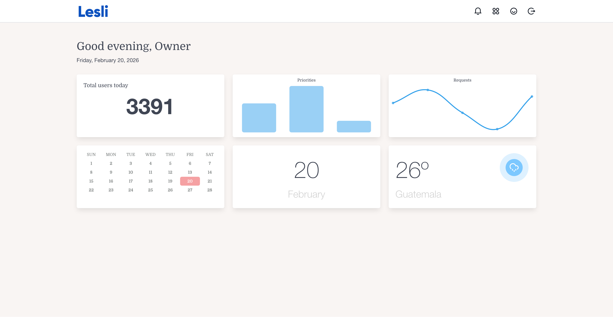

<div align="center">
    <h1 align="center">
        
    </h1>
    <h3 align="center">Configurable dashboards for the Lesli Framework.</h3>
</div>

<br />

<div align="center">
    <a target="_blank" href="https://github.com/LesliTech/LesliDashboard/actions/workflows/lesli-ci.yaml">
        
    </a>
    <a target="_blank" href="https://rubygems.org/gems/lesli_dashboard">
        
    </a>
    <a target="_blank" href="https://codecov.io/github/LesliTech/LesliDashboard">
        
    </a>
    <a target="_blank" href="https://sonarcloud.io/project/overview?id=LesliTech_LesliDashboard">
        
    </a>
</div>

<br />

<div align="center">
    
</div>

---

<br />

## Introduction

LesliDashboard is the official dashboard engine for the [Lesli Framework](https://github.com/LesliTech/Lesli).

It lets applications compose reusable, configurable dashboards from account-scoped components.

<br />

## Features

- Multiple account-scoped dashboards
- Reusable dashboard components
- Configurable component position and size
- Component-specific configuration
- Shared dashboards for teams and workflows

<br />

## Try LesliDashboard

- [Try the online demo](https://demo.lesli.dev/)
- [Run the Docker demo](https://github.com/LesliTech/lesli-docker-demo)

<br />

## Quick Start

### Requirements

- A Rails application with [Lesli](https://rubygems.org/gems/lesli)
- SQLite by default, or PostgreSQL when preferred by the host application

### Install LesliDashboard

Add the engine to the host Rails application and prepare its database:

```shell
bundle add lesli_dashboard
bin/rails lesli:db:prepare
```

### Mount the engine

Applications using Lesli's standard router mount LesliDashboard automatically at `/dashboard`:

```ruby
# config/routes.rb
Rails.application.routes.draw do
    Lesli::Router.mount(self)
end
```

If the application does not use the standard Lesli router, mount the engine directly:

```ruby
# config/routes.rb
Rails.application.routes.draw do
    mount LesliDashboard::Engine => "/dashboard"
end
```

Start Rails and visit [http://127.0.0.1:3000/dashboard](http://127.0.0.1:3000/dashboard):

```shell
bin/rails server
```

<br />

## Development

Clone LesliDashboard into the host application's `engines` directory:

```shell
cd RailsApp
mkdir -p engines
git clone https://github.com/LesliTech/LesliDashboard.git engines/LesliDashboard
```

Reference the local engine from the host application's `Gemfile`:

```ruby
gem "lesli_dashboard", path: "engines/LesliDashboard"
```

Install dependencies, prepare the host database, and start Rails:

```shell
bundle install
bin/rails lesli:db:prepare
bin/rails server
```

### Tests

From a complete Lesli development workspace, run the engine test suite from the LesliDashboard directory:

```shell
cd engines/LesliDashboard
bin/rails test
```

<br />

## Documentation

- [Lesli website](https://www.lesli.dev/)
- [Documentation](https://www.lesli.dev/engines/dashboard)
- [Release notes](https://github.com/LesliTech/LesliDashboard/releases)
- [Issue tracker](https://github.com/LesliTech/LesliDashboard/issues)
- [Source code](https://github.com/LesliTech/LesliDashboard)

<br />

## Community

- [X: @LesliTech](https://x.com/LesliTech)
- [hello@lesli.tech](mailto:hello@lesli.tech)
- [https://www.lesli.tech](https://www.lesli.tech)

<br />

## License

Copyright (c) 2026, Lesli Technologies, S. A.

This program is free software: you can redistribute it and/or modify
it under the terms of the GNU General Public License as published by
the Free Software Foundation, either version 3 of the License, or
(at your option) any later version.

This program is distributed in the hope that it will be useful,
but WITHOUT ANY WARRANTY; without even the implied warranty of
MERCHANTABILITY or FITNESS FOR A PARTICULAR PURPOSE. See the
GNU General Public License for more details.

You should have received a copy of the GNU General Public License
along with this program. If not, see [https://www.gnu.org/licenses/](https://www.gnu.org/licenses/).

The complete license text is available in the [license file](./license).

---

<br />
<br />

<div align="center">
    
    <h3 align="center">The Open-Source SaaS Development Framework for Ruby on Rails.</h3>
</div>
